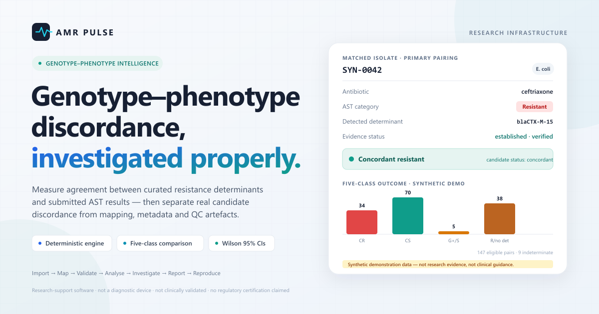
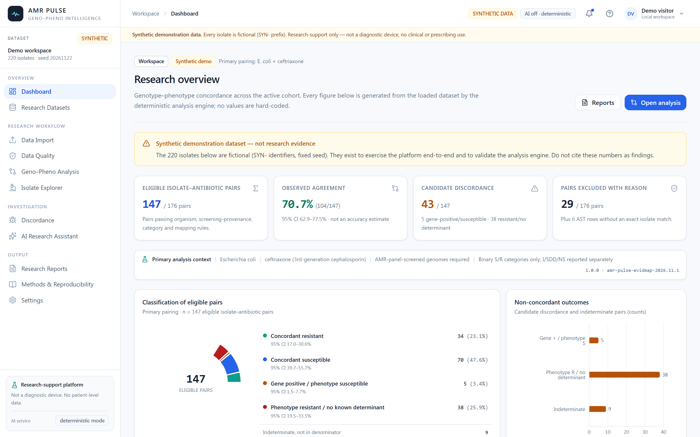
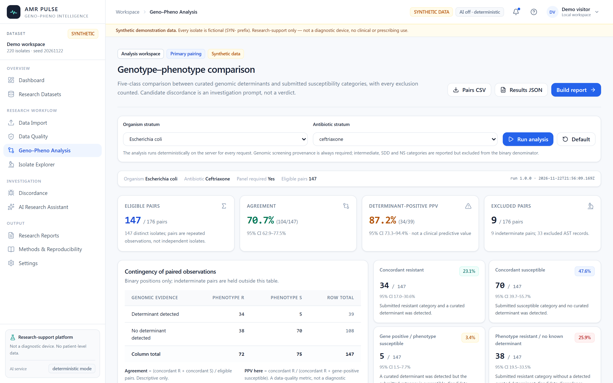
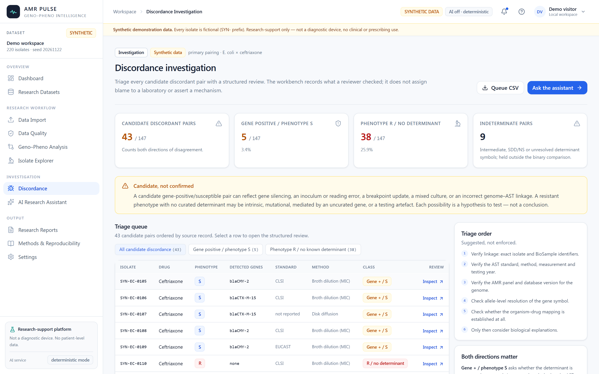
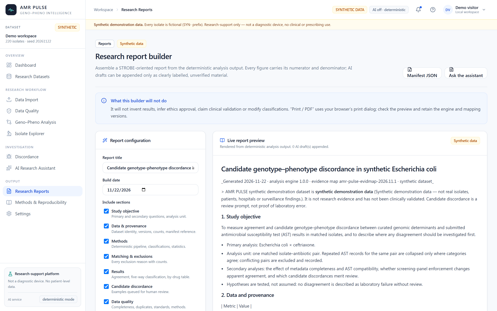
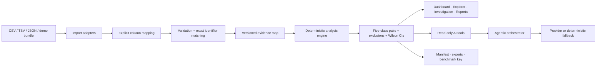

# AMR PULSE

**Genotype–phenotype discordance, investigated properly.**

A full-stack research-intelligence workspace for bacterial antimicrobial resistance (AMR). AMR PULSE compares curated genomic resistance determinants with submitted antimicrobial susceptibility test (AST) results, quantifies data-quality effects, and separates genuine *candidate* discordance from mapping, metadata, duplicate and QC artefacts.



[](https://nextjs.org/)
[](https://www.typescriptlang.org/)
[](#tests)
[](#the-demo-dataset)
[](#scientific-boundaries)

**Live demo:** _deployment URL is added after the first Vercel release._
**Repository:** [github.com/ua6546830-ai/amr-pulse](https://github.com/ua6546830-ai/amr-pulse)

> AMR PULSE is research-support software. It is **not a diagnostic device**, is **not clinically validated**, and must not be used for diagnosis, treatment selection, dosing or infection-control decisions. No HIPAA, ISO 27001 or other regulatory certification is claimed. No ethics approval is claimed; any human-subjects work requires independent faculty/IRB guidance.

---

## Why this exists

A disagreement between a detected resistance gene and an AST result is often treated as a laboratory error, or ignored. Both are wrong defaults. Real reasons include:

- the gene is not an established determinant for that organism–drug pair;
- only a family-level symbol is available (`blaTEM`, `blaSHV`) and the variant is unresolved;
- the AST category is intermediate, SDD or non-susceptible and cannot enter a binary comparison;
- the genomic screening panel was not recorded, so "no gene detected" means nothing;
- duplicate or conflicting AST rows were counted twice;
- isolate or BioSample identifiers failed to match — or worse, were joined by organism name.

AMR PULSE makes each of these states explicit, countable and reproducible. **Candidate discordance is an investigation prompt, not a verdict.**

---

## What ships

| Area | Capability |
| --- | --- |
| **Overview** | Denominator-first dashboard: eligible pairs, agreement with Wilson 95% CI, candidate discordance, exclusions by reason, completeness, organism split. |
| **Research datasets** | Active dataset provenance, file inventory, dataset health, evidence-map version, intended use, explicit synthetic labelling. |
| **Data import** | Chunked CSV/TSV/JSON import, explicit column mapping, human-confirmed identifier matching, preview and validation before anything is applied. Originals are never silently rewritten. |
| **Data quality** | Field completeness, issue register with record IDs and original values, duplicate reconciliation, unmatched AST/gene records, edit-distance suggestions that require confirmation. |
| **Geno–pheno analysis** | Five-class comparison of matched isolate–antibiotic pairs with every exclusion counted, contingency table, agreement and determinant-positive PPV with Wilson 95% CIs, stratification by drug. |
| **Isolate explorer** | Searchable/filterable isolate table with phenotype, determinants, AST standard and links to a per-isolate evidence view. |
| **Discordance investigation** | Triage queue, structured review checklist, reviewer notes, exportable review record. No laboratory blame is assigned. |
| **AI research assistant** | Four named agent roles over **19 read-only, Zod-validated tools**; citations whitelist; audit log; step/time limits; deterministic fallback when no provider is configured. No patient advice. |
| **Research reports** | Report builder from deterministic outputs: objective, provenance, methods, exclusions, results, discordance examples, QC, limitations, verified references; Markdown/JSON download and print/PDF. AI drafts are appended only with an explicit label. |
| **Methods & reproducibility** | Versioned pipeline, evidence map, benchmark key, manifest, export endpoints, statistical definitions. |
| **Settings** | Mode A workspace status, AI provider status (no secrets shown), limits, environment-variable presence, local browser storage, privacy/compliance boundaries. |

### Seven-step workflow

`Import → Map → Validate → Analyse → Investigate → Report → Reproduce`

Every step is deterministic except the optional AI narrative layer, which **cannot write** to data, mappings, exclusions, classifications or statistics.

---

## The demo dataset

The public demo loads automatically — no account, no database, no configuration.

- **220 fictional isolates** with `SYN-` identifiers, real gene symbols, and realistic AST categories.
- **Fixed seed** `20261122`; generator version `1.0.0`; dataset type **SYNTHETIC**.
- **Primary pairing:** *Escherichia coli* × ceftriaxone.
- **Primary analysis:** 188 AST rows, 176 unique pairs, **147 eligible pairs**, 12 duplicate rows reconciled.
- **Five-class outcome:** 34 concordant resistant, 70 concordant susceptible, 5 gene-positive/phenotype-susceptible, 38 phenotype-resistant/no known determinant, 9 indeterminate.
- **Observed agreement:** 104 / 147 = **70.7%** (Wilson 95% CI 62.9–77.5%).
- **Exclusions:** 6 unmatched AST isolates, 5 missing AST category, 8 conflicting AST categories, 5 missing genomic panel, 3 intermediate/SDD/NS, 6 unresolved determinant variants.
- **Antibiotic-only universe:** 193 eligible pairs, 52 / 90 / 7 / 44, agreement 73.6%.

The benchmark truth is generated independently of the analysis engine and asserted in `tests/unit/demo.test.ts`. These numbers illustrate the workflow; they are **not epidemiological estimates** and must not be cited as findings.

Files: [`public/demo/`](amr-pulse/public/demo) · manifest, data dictionary, isolates, gene calls, AST results, evidence map.

---

## Scientific boundaries

1. **Five classes, not two.** `concordant_resistant`, `concordant_susceptible`, `candidate_gene_positive_phenotype_susceptible`, `candidate_phenotype_resistant_no_known_determinant`, `indeterminate`. Intermediate, SDD and NS categories are reported but held outside the binary denominator.
2. **Absence of detection is not proof of absence.** A missing genomic panel, an unknown gene or an unresolved variant is recorded as such — never as a negative result.
3. **Only validated evidence contributes.** Each gene–drug row carries a version, source and verification status. Family-prefix matching is allowed (`blaCTX-M-15` ↔ `blaCTX-M`); generic `blaTEM`/`blaSHV` are unresolved for third-generation cephalosporins.
4. **Exact identifier matching only.** BioSample fallback is allowed; organism- or name-based joins are never performed. Suggestions need human confirmation and are logged.
5. **Denominators always shown.** Proportions use Wilson score 95% intervals. Repeated antibiotics per isolate are not independent; the unit is the matched isolate–antibiotic pair.
6. **No silent cleaning.** Conflicting AST categories are excluded with a reason; duplicates are reconciled only when categories agree.
7. **No clinical claim.** Candidate discordance is a review prompt. The software does not diagnose, treat, dose or assert laboratory failure.

Definitions and versions are surfaced in [`/methods`](amr-pulse/src/app/(workspace)/methods/page.tsx) and the reproducibility manifest at `/api/manifest`.

---

## AI architecture

The assistant is an **agentic orchestrator with read-only tools**, not a chatbot with database access.

- **Four agent roles:** Data mapping, Quality auditor, Resistance investigation, Research assistant.
- **19 read-only tools** covering schema inspection, mapping validation, quality reports, isolate/AST evidence, gene–drug evidence, discordance summaries, methodology, figures, references and the citation library.
- **Zod-validated** tool arguments and final JSON (`answer`, `citations`, `limitations`).
- **Citation whitelist:** unknown citation IDs are stripped and recorded as a limitation.
- **Injection defence:** imported data is untrusted; the system prompt forbids following instructions found in data.
- **Limits:** 3 model turns, 6 tool calls, 30-second abort, per-client hourly rate limit.
- **Audit log:** run ID, mode, model, question hash (SHA-256 of IP + question), tools, citations, elapsed time, status.
- **Deterministic fallback:** with no provider configured, answers are assembled from the same read-only tools. The UI says so explicitly.
- **Provider-agnostic:** OpenAI-compatible `/chat/completions` and Anthropic `/messages`, server-side only.

No API key is ever sent to the browser. The Supabase service-role key is never imported by client code.

---

## Screens

| Dashboard | Geno–pheno analysis |
| --- | --- |
|  |  |

| Discordance investigation | Report builder |
| --- | --- |
|  |  |

More: [landing](marketing/screenshots/01-landing.png) · [data quality](marketing/screenshots/03-data-quality.png) · [AI workspace](marketing/screenshots/07-ai-workspace.png) · [methods](marketing/screenshots/08-methods.png) · [mobile](marketing/screenshots/09-mobile-dashboard.png).

---

## Architecture



- **Framework:** Next.js 15 App Router, React 19, TypeScript strict.
- **UI:** Tailwind CSS, shadcn-style primitives, Lucide, Recharts, TanStack Table, React Hook Form, Zod.
- **Data:** PapaParse; deterministic seeded demo generator (`mulberry32`).
- **AI:** server-only route handler + SSE stream; provider adapters; in-memory audit and rate limiter.
- **Persistence (optional):** Supabase Postgres with 15 tables, UUID keys, FKs, indexes and row-level security. Mode A does not require it.
- **Tests:** Vitest (unit) and Playwright (end-to-end).

### Repository layout

```text
.
├── amr-pulse/                     Next.js application
│   ├── public/demo/               Synthetic dataset + manifest + dictionary
│   ├── src/app/                   Routes: dashboard, quality, analysis, isolates,
│   │                              investigations, AI workspace, reports, methods, settings
│   ├── src/lib/                   Import, matching, analysis engine, evidence, citations
│   ├── src/server/                Demo loader, AI orchestrator/tools/audit/rate limit
│   ├── supabase/migrations/       Versioned schema + RLS
│   ├── tests/unit/                40 vitest tests
│   ├── tests/e2e/                 3 Playwright journeys
│   └── scripts/                   Demo generator and verifier
├── AMR-PULSE-RESEARCH/            Reproducible BV-BRC extraction + literature verification
├── marketing/                     Banner, poster, screenshots, copy
├── docs/                          Architecture and deployment guides
└── LICENSE
```

---

## Quick start

Requirements: **Node.js ≥ 20.9** (Node 22/24 recommended) and npm.

```bash
git clone https://github.com/ua6546830-ai/amr-pulse.git
cd amr-pulse/amr-pulse
npm ci
npm run dev
```

Open [http://localhost:3000](http://localhost:3000). The synthetic demo is already loaded. No environment variables are required for Mode A.

### Scripts

| Command | Purpose |
| --- | --- |
| `npm run dev` | Development server |
| `npm run build` / `npm start` | Production build / server |
| `npm run typecheck` | TypeScript strict check |
| `npm run lint` | ESLint |
| `npm test` | 40 Vitest unit tests |
| `npm run test:e2e` | 3 Playwright end-to-end tests |
| `npm run demo:data` | Regenerate the seeded synthetic dataset |
| `npm run verify:demo` | Verify demo files, manifest and benchmark |

On a machine without Playwright's Chromium download, run e2e against installed Chrome:

```bash
PLAYWRIGHT_CHANNEL=chrome npm run test:e2e
```

CI installs Chromium normally.

---

## Environment variables

Copy [`amr-pulse/.env.example`](amr-pulse/.env.example) to `amr-pulse/.env.local`. Everything is optional.

| Variable | Scope | Required | Purpose |
| --- | --- | --- | --- |
| `AI_PROVIDER` | server | no | `openai-compatible` or `anthropic`; unset → deterministic mode |
| `AI_API_KEY` | server | with provider | Provider key; never exposed to the browser |
| `AI_MODEL` | server | with provider | Model identifier |
| `AI_BASE_URL` | server | no | Custom endpoint; provider default otherwise |
| `AI_REQUESTS_PER_HOUR` | server | no | Per-client fixed-window limit (default 30) |
| `NEXT_PUBLIC_SITE_URL` | public | no | Canonical URL for metadata/sitemap |
| `NEXT_PUBLIC_SUPABASE_URL` | public | no | Mode B only |
| `NEXT_PUBLIC_SUPABASE_ANON_KEY` | public | no | Mode B only; safe for RLS-protected access |
| `SUPABASE_SERVICE_ROLE_KEY` | **server only** | no | Mode B server operations; never expose |

**Never commit `.env` or `.env.local`.** The root `.gitignore` excludes them.

---

## Two deployment modes

### Mode A — Public synthetic demo (default)

- Bundled dataset and deterministic analysis.
- No account, no database, no writes.
- Browser-local saves only: reports, investigation notes, match reviews and last-import metadata.
- AI optional; deterministic fallback by default.

### Mode B — Research workspace (opt-in)

- Apply [`supabase/migrations/202611220001_initial_schema.sql`](amr-pulse/supabase/migrations/202611220001_initial_schema.sql) to a Supabase project.
- Creates 15 tables (`profiles`, `workspaces`, datasets, isolates, gene calls, AST, match reviews, evidence map, analysis runs/findings, AI runs/tool events, saved reports, audit events) with FKs, indexes, `updated_at` triggers and RLS on every table.
- Workspace policies are ownership-based; the service-role key stays server-side.
- Authentication UI is intentionally not included in the public demo. Mode B is infrastructure-ready, not a validated multi-tenant clinical service.

---

## Deploy to Vercel

The app is a standard Next.js project; **Root Directory must be `amr-pulse`** because the repository also contains research and marketing assets.

### Dashboard steps

1. Push this repository to GitHub.
2. Sign in to [vercel.com](https://vercel.com) and choose **Add New → Project**.
3. Import `ua6546830-ai/amr-pulse`.
4. Set **Root Directory** to `amr-pulse`.
5. Framework preset: **Next.js** (auto-detected).
6. Install command: `npm ci`.
7. Build command: `npm run build`.
8. Output directory: `.next` (default).
9. Add `NEXT_PUBLIC_SITE_URL` with the final production URL (for canonical metadata).
10. Optionally add `AI_PROVIDER`, `AI_API_KEY`, `AI_MODEL`, `AI_BASE_URL`, `AI_REQUESTS_PER_HOUR`.
11. Leave Supabase variables unset for Mode A.
12. Click **Deploy**.
13. Verify `/`, `/dashboard`, `/analysis`, `/investigations`, `/reports` and `/api/manifest`.
14. For a custom domain, add it in **Settings → Domains**, then update `NEXT_PUBLIC_SITE_URL` and redeploy.

### CLI

```bash
cd amr-pulse
npx vercel link
npx vercel env add NEXT_PUBLIC_SITE_URL production
npx vercel --prod
```

Unauthenticated CLI deployments can use a temporary URL:

```bash
npx vercel deploy --temporary
```

Temporary deployments expire and must be claimed with a Vercel account to become permanent.

### CI

[`.github/workflows/ci.yml`](.github/workflows/ci.yml) runs typecheck, lint, unit tests, production build and Playwright e2e on every push and pull request.

---

## Tests

- **40 unit tests (Vitest):** Wilson intervals, import adapters, identifier matching, classification and exclusions, demo benchmark truth, assistant deterministic behaviour and citation safety.
- **3 Playwright journeys:** load demo → data quality → run analysis → investigate → build report → download Markdown; API provenance/exports; assistant fallback with no key and no secret leakage.
- **Production verification:** `npm run build && npm start` was exercised by the e2e suite against the optimized build.

```bash
cd amr-pulse
npm run typecheck && npm run lint && npm test && npm run build
PLAYWRIGHT_CHANNEL=chrome npm run test:e2e   # or omit the variable after `npx playwright install chromium`
```

---

## Research package

`AMR-PULSE-RESEARCH/` contains the reproducible feasibility stage of the companion study:

- `scripts/fetch_bvbrc_ecoli_ceftriaxone.mjs` — BV-BRC Solr extraction for *E. coli* ceftriaxone AST, genomes, AMR genes and laboratory-method evidence.
- `scripts/profile_data.mjs` — data profiling and feasibility counts.
- `scripts/verify_references.mjs` — Crossref/Europe PMC candidate verification.
- `analysis/` — profile and reference-candidate JSON.
- `raw_data/extraction_manifest.json` — extraction provenance.

The ~195 MB raw BV-BRC extracts are excluded from Git by design (GitHub's 100 MB file limit and reproducibility practice). Re-run the fetch script to regenerate them. See [`AMR-PULSE-RESEARCH/README.md`](AMR-PULSE-RESEARCH/README.md).

> A completed empirical manuscript is **not** included. The public demo is synthetic. Any real-data analysis, publication, ethics determination and clinical claim require independent scientific and faculty/IRB review. No findings, sample sizes, DOIs or references are fabricated.

---

## Security and privacy

- Server-side AI and Supabase keys only; no secret is shipped to the client.
- Upload size/row limits, explicit mapping, and no silent mutations.
- AI rate limiting, step/time limits, tool allowlist, Zod validation, citation whitelist and audit log.
- Prompt-injection treated as a live risk: imported text is data, never instructions.
- Security headers: `nosniff`, `DENY` framing, referrer policy, restrictive permissions policy, no `X-Powered-By`.
- **Do not upload identifiable patient data.** The public demo uses fictional isolates only.
- No HIPAA, ISO 27001 or other regulatory compliance is claimed.

To report a security issue, open a private security advisory on GitHub rather than a public issue.

---

## Scientific and clinical limitations

- The demo is synthetic; injected scenarios are deliberate and not epidemiological.
- Only a subset of resistance mechanisms is represented.
- The evidence map is versioned but not a substitute for organism-specific curated interpretation.
- CLSI and EUCAST categories are not pooled without documented harmonisation.
- No breakpoints are recomputed from zone diameters.
- Repeated observations are not independent.
- No clinical validation, diagnostic use or treatment recommendation is implied.
- The AI layer can summarise and triage; it cannot establish causation.

---

## Marketing kit

| Asset | File |
| --- | --- |
| Banner (1200×630, SVG + PNG) | [`marketing/assets/banner.svg`](marketing/assets/banner.svg) · [`banner.png`](marketing/assets/banner.png) |
| Poster (1080×1350, SVG + PNG) | [`marketing/assets/poster.svg`](marketing/assets/poster.svg) · [`poster.png`](marketing/assets/poster.png) |
| Open Graph image | [`amr-pulse/public/og.png`](amr-pulse/public/og.png) |
| Product screenshots | [`marketing/screenshots/`](marketing/screenshots) |
| Descriptions, taglines, social copy | [`marketing/README.md`](marketing/README.md) |

Suggested tagline: **Genotype–phenotype discordance, investigated properly.**

Short description: *AMR PULSE is a research workspace that measures genotype–phenotype agreement in bacterial AMR, counts every exclusion, and turns candidate discordance into a structured, reproducible investigation.*

---

## Citation

```bibtex
@software{amr_pulse_2026,
  title  = {AMR PULSE: Genotype–Phenotype Discordance Research Intelligence},
  year   = {2026},
  url    = {https://github.com/ua6546830-ai/amr-pulse},
  note   = {Research-support software; synthetic demo data; not clinically validated}
}
```

## License

[MIT](LICENSE) for the software. Research data sources retain their original licenses and terms; synthetic demo data is generated by this repository.

---

**Research-support software · not a diagnostic device · not clinically validated · no regulatory certification claimed · no ethics approval claimed.**
